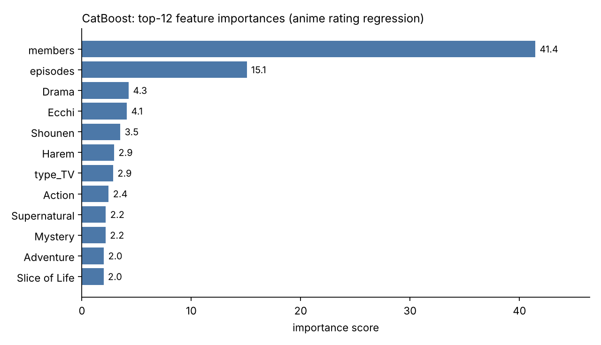

# Sensor-Based_Surface_Classification

**Predicting the average rating of an anime from its genres, type, number of episodes and popularity: five regression models compared on a multi-gigabyte table, with DVC for the data and the training stage.**

English | [Русский](README.ru.md)



A study project on tabular regression and data versioning. User ratings (`rating.csv`) are joined with the anime
catalogue (`anime.csv`: `anime_id, name, genre, type, episodes, rating, members`), genres are one-hot encoded, the title
length is added as a feature, and the target is the average rating of the title (`rating_y`). Linear regression, a
decision tree, CatBoost, XGBoost and an MLP are tuned with Optuna, saved as `.pkl` files and compared on the same table
by MSE, MAE and R². The big table and the CatBoost training stage are tracked with DVC, so a model can be reproduced
from a commit.

## Features

* **Feature pipeline** (`ML.py`): merge of ratings and catalogue, multi-label one-hot encoding of genres
  (`MultiLabelBinarizer`), dummies for the title type, number of words in the title, `episodes` and `members`.
* **Five models**, each in its own script with an Optuna search: `linear_regression.py`, `tree.py`
  (50 trials, depth 3–6), `catboost_learning.py`, `xgboost_learning.py`, `neural_network.py` (`MLPRegressor` with a
  searched architecture).
* **Side-by-side comparison** (`final_comparison.py`): loads the five saved models, prints MSE / MAE / R², draws
  predicted-vs-true plots, linear weights, the first nodes of the tree and feature importances.
* **Explainability artefacts**: `catboost_feature_importance.csv`, `xgboost_feature_importance.png`,
  `linear_regression_results.txt` (weights per feature), MLP weight and bias plots per layer.
* **DVC**: a `train_tree` stage in `dvc.yaml` (the CatBoost run: `df.csv` + `catboost_learning.py` → `catboost_optuna.pkl`)
  with a lock file, and `df_final_for_lr_cleaned.csv.dvc` for the ~3.8 GB cleaned table.

In the CatBoost model the strongest features are `members` and `episodes` (importance ≈ 41 and ≈ 15), then single
genres (Drama, Ecchi, Shounen) and the TV type; the figure above is drawn from `catboost_feature_importance.csv`.
The other plots (predicted vs true, error histogram, linear weights, MLP layers) are produced by `final_comparison.py`
and the training scripts and are kept in the repository root.

## Requirements

* Python ≥ 3.10;
* pandas, numpy, scikit-learn, CatBoost, XGBoost, Optuna, joblib, matplotlib, seaborn;
* [DVC](https://dvc.org) if you want to pull or reproduce the tracked data and stage;
* the raw tables: `anime.csv` is in the repository, `rating.csv` (user ratings of the same public anime dataset) is not,
  and neither are the derived `df*.csv` files (hundreds of MB to several GB).

```bash
pip install pandas numpy scikit-learn catboost xgboost optuna joblib matplotlib seaborn "dvc"
```

## Quick start

```bash
git clone https://github.com/<your-account>/dvc.git && cd dvc

# 1. put rating.csv next to anime.csv and build the features
python ML.py                       # writes X_cleaned.csv and Y_cleaned.csv

# 2. train a model (each script reads its table, runs Optuna, saves a .pkl)
python tree.py
python catboost_learning.py
python xgboost_learning.py
python neural_network.py
python linear_regression.py

# 3. compare all five
python final_comparison.py
```

The training scripts read the final feature table under the names used in the code (`df_final_for_lr.csv`,
`df_final_for_lr_cleaned.csv`, `df.csv`). No script in the repository writes `df_final_for_lr.csv` from
`X_cleaned.csv` / `Y_cleaned.csv` (the target column is called `rating_y`), so assemble it yourself, or change the file
names at the top of a script.

### Reproducing the DVC stage

```bash
dvc repro                          # runs: python catboost_learning.py df.csv catboost_optuna.pkl
dvc dag
```

> The DVC remote in `.dvc/config` points to a local disk (`E:/dvc_storage`). To pull the data on another machine, add
> your own remote first: `dvc remote add -d storage <path-or-url>` and `dvc push` / `dvc pull`.

## Repository layout

```
ML.py                         feature pipeline: ratings + anime → X, Y
linear_regression.py          linear model (+ Optuna), linear_regression_testing.py
tree.py, tree_testing.py      decision tree (Optuna, MAE)
catboost_learning.py          CatBoost (Optuna)           ← DVC stage train_tree
xgboost_learning.py           XGBoost (Optuna)
neural_network.py             MLPRegressor (Optuna, searched layers)
final_comparison.py           MSE / MAE / R² for all models, comparison plots
corellation_matrix.py         correlation matrix of the table
new_csv.py                    cleaning of df_final_for_lr.csv → df_final_for_lr_cleaned.csv
dvc.yaml, dvc.lock            pipeline
df_final_for_lr_cleaned.csv.dvc   tracked table
*.pkl                         trained models and the scaler
*.png, *.csv, *.txt           plots, importances, weights
```

## Notes

* `rating_y` is a property of the title, while the table has one row per user rating, so the same title appears many
  times with identical features. A random train/test split therefore puts copies of a title on both sides; for a strict
  estimate split by `anime_id`.
* Feature importance is computed on the fitted models and is not a causal statement about what makes an anime popular.
