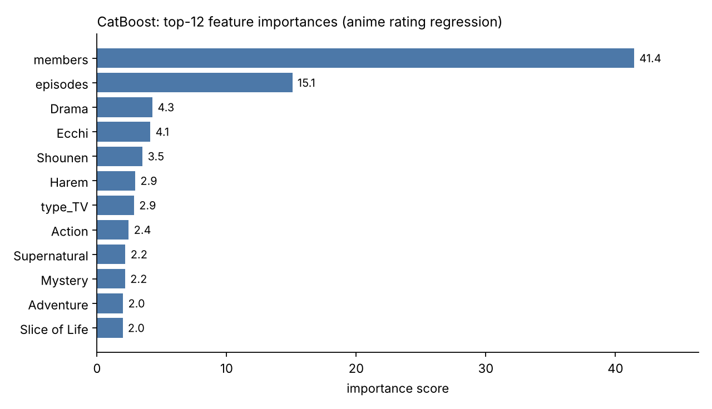

# Классификация поверхности по проприоцептивным данным

**Предсказание среднего рейтинга аниме по жанрам, типу, числу серий и популярности: пять регрессионных моделей на многогигабайтной таблице, данные и обучение версионируются через DVC.**

[English](README.md) | Русский



Учебный проект по табличной регрессии и версионированию данных. Пользовательские оценки (`rating.csv`) объединяются с
каталогом аниме (`anime.csv`: `anime_id, name, genre, type, episodes, rating, members`), жанры кодируются one-hot,
добавляется длина названия, целевая переменная — средний рейтинг тайтла (`rating_y`). Линейная регрессия, решающее
дерево, CatBoost, XGBoost и MLP подбираются Optuna, сохраняются в `.pkl` и сравниваются на одной таблице по MSE, MAE и
R². Большая таблица и стадия обучения CatBoost отслеживаются DVC, так что модель можно воспроизвести из коммита.

## Возможности

* **Подготовка признаков** (`ML.py`): объединение оценок и каталога, мультиметочное one-hot кодирование жанров
  (`MultiLabelBinarizer`), dummy-признаки типа тайтла, число слов в названии, `episodes` и `members`.
* **Пять моделей**, у каждой свой скрипт с поиском по Optuna: `linear_regression.py`, `tree.py` (50 испытаний,
  глубина 3–6), `catboost_learning.py`, `xgboost_learning.py`, `neural_network.py` (`MLPRegressor` с подбором
  архитектуры).
* **Сравнение бок о бок** (`final_comparison.py`): загружает пять сохранённых моделей, печатает MSE / MAE / R², строит
  графики «предсказание — истина», веса линейной модели, первые узлы дерева и важности признаков.
* **Артефакты для интерпретации**: `catboost_feature_importance.csv`, `xgboost_feature_importance.png`,
  `linear_regression_results.txt` (веса по признакам), графики весов и смещений MLP по слоям.
* **DVC**: стадия `train_tree` в `dvc.yaml` (запуск CatBoost: `df.csv` + `catboost_learning.py` →
  `catboost_optuna.pkl`) с lock-файлом и `df_final_for_lr_cleaned.csv.dvc` для очищенной таблицы ≈ 3,8 ГБ.

В модели CatBoost самые сильные признаки — `members` и `episodes` (важность ≈ 41 и ≈ 15), дальше отдельные жанры
(Drama, Ecchi, Shounen) и тип TV; рисунок выше построен по `catboost_feature_importance.csv`. Остальные графики
(предсказание против истины, гистограмма ошибок, веса линейной модели, слои MLP) создаются `final_comparison.py` и
скриптами обучения и лежат в корне репозитория.

## Требования

* Python ≥ 3.10;
* pandas, numpy, scikit-learn, CatBoost, XGBoost, Optuna, joblib, matplotlib, seaborn;
* [DVC](https://dvc.org), если нужно подтянуть или воспроизвести отслеживаемые данные и стадию;
* исходные таблицы: `anime.csv` есть в репозитории, `rating.csv` (пользовательские оценки того же открытого датасета
  аниме) — нет, как и производных `df*.csv` (от сотен МБ до нескольких ГБ).

```bash
pip install pandas numpy scikit-learn catboost xgboost optuna joblib matplotlib seaborn "dvc"
```

## Быстрый старт

```bash
git clone https://github.com/<your-account>/dvc.git && cd dvc

# 1. положите rating.csv рядом с anime.csv и постройте признаки
python ML.py                       # пишет X_cleaned.csv и Y_cleaned.csv

# 2. обучите модель (каждый скрипт читает свою таблицу, запускает Optuna и сохраняет .pkl)
python tree.py
python catboost_learning.py
python xgboost_learning.py
python neural_network.py
python linear_regression.py

# 3. сравните все пять
python final_comparison.py
```

Скрипты обучения читают итоговую таблицу признаков под именами из кода (`df_final_for_lr.csv`,
`df_final_for_lr_cleaned.csv`, `df.csv`). Ни один скрипт в репозитории не собирает `df_final_for_lr.csv` из
`X_cleaned.csv` / `Y_cleaned.csv` (целевой столбец называется `rating_y`), поэтому соберите её сами или поменяйте имена
файлов в начале скрипта.

### Воспроизведение стадии DVC

```bash
dvc repro                          # выполнит: python catboost_learning.py df.csv catboost_optuna.pkl
dvc dag
```

> Remote DVC в `.dvc/config` указывает на локальный диск (`E:/dvc_storage`). Чтобы получить данные на другой машине,
> сначала добавьте свой remote: `dvc remote add -d storage <путь-или-url>`, затем `dvc push` / `dvc pull`.

## Структура репозитория

```
ML.py                         подготовка признаков: оценки + аниме → X, Y
linear_regression.py          линейная модель (+ Optuna), linear_regression_testing.py
tree.py, tree_testing.py      решающее дерево (Optuna, MAE)
catboost_learning.py          CatBoost (Optuna)           ← стадия DVC train_tree
xgboost_learning.py           XGBoost (Optuna)
neural_network.py             MLPRegressor (Optuna, подбор слоёв)
final_comparison.py           MSE / MAE / R² для всех моделей, графики сравнения
corellation_matrix.py         корреляционная матрица таблицы
new_csv.py                    очистка df_final_for_lr.csv → df_final_for_lr_cleaned.csv
dvc.yaml, dvc.lock            пайплайн
df_final_for_lr_cleaned.csv.dvc   отслеживаемая таблица
*.pkl                         обученные модели и скейлер
*.png, *.csv, *.txt           графики, важности, веса
```

## Замечания

* `rating_y` — свойство тайтла, а в таблице одна строка на каждую пользовательскую оценку, поэтому один и тот же тайтл
  встречается много раз с одинаковыми признаками. Случайное разбиение train/test кладёт копии тайтла по обе стороны;
  для строгой оценки разбивайте по `anime_id`.
* Важность признаков считается по обученным моделям и не является причинным утверждением о том, что делает аниме
  популярным.
